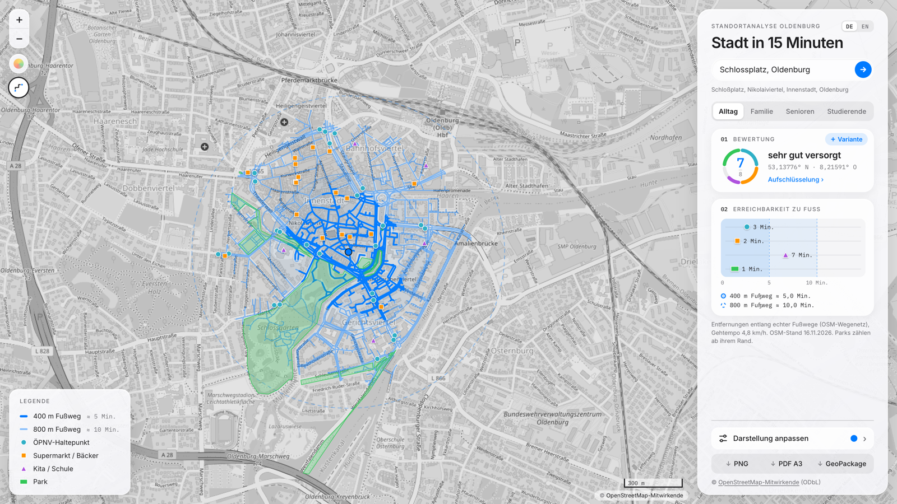
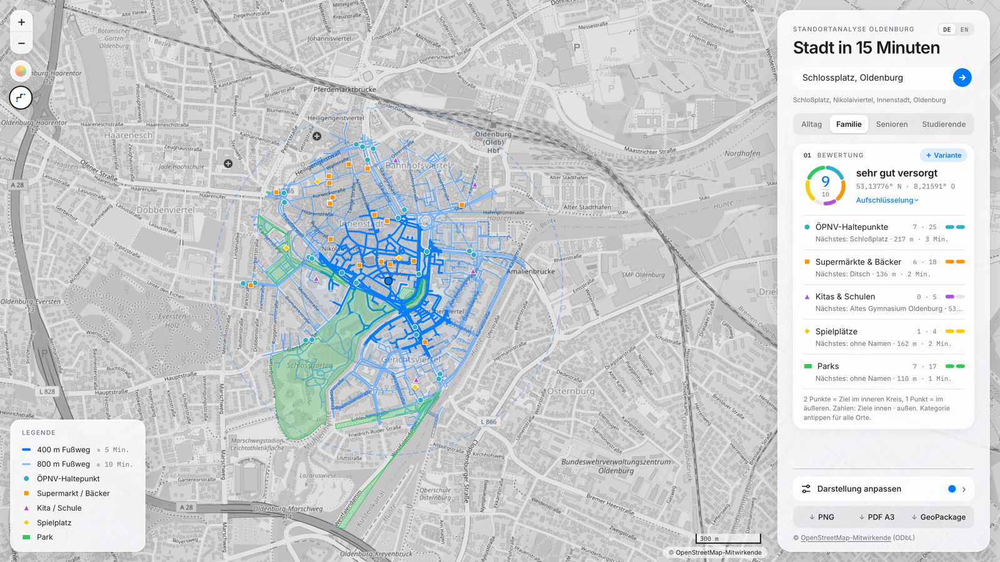
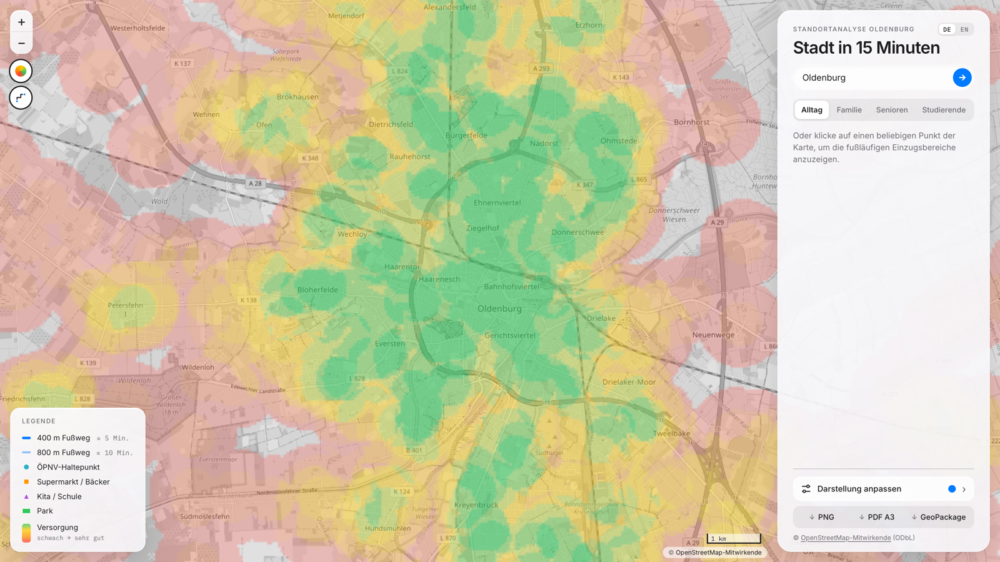
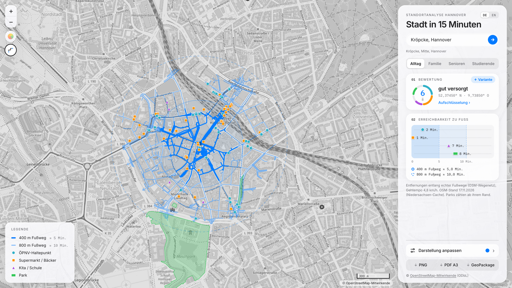
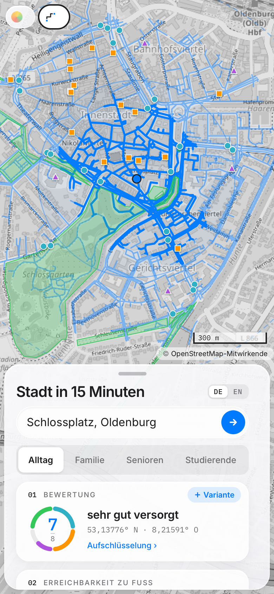

# Stadt in 15 Minuten

**Ein Klick auf die Karte zeigt, was man von diesem Ort aus in 5 und 10 Minuten zu Fuß erreicht – und bewertet den Standort nach der Idee der „15-Minuten-Stadt“.**

**Live-Demo:** https://jade-hs-vibecoding-wpk.github.io/15-min-stadt-scanner/

Ein Werkzeug für die städtebauliche Standortanalyse im Architekturstudium: Haltestellen, Supermärkte, Kitas, Schulen, Ärzte, Cafés, Spielplätze und Parks werden entlang **echter Fußwege** gezählt, als Punktzahl bewertet und als Plan (PNG, PDF A3) oder als GIS-Datei für QGIS (GeoPackage) ausgegeben.
Entstanden im Wahlpflichtkurs „Thinking Architecture through Software Design · Vibecoding KI-Werkstatt“ an der Jade Hochschule (November 2026).



---

## Was das Tool kann

| | |
|---|---|
| **Bewertung** | Ring mit Punktzahl (z. B. 7/8) und Stufe von „schwach“ bis „sehr gut versorgt“. „Aufschlüsselung“ zeigt je Kategorie Punkte, Anzahl der Ziele und das nächste Ziel mit Gehzeit; ein Klick auf eine Kategorie listet alle Orte. |
| **Echte Fußwege** | Entfernungen entlang des OpenStreetMap-Wegenetzes statt Luftlinie. Die Karte zeigt, welche Wege in 5 bzw. 10 Minuten erreichbar sind. Umschalter „Fußwege / Luftlinie“ zum Vergleich. |
| **Zielgruppen-Profile** | Alltag · Familie (+ Spielplätze) · Senioren (+ Ärzte, Cafés & Kultur) · Studierende (+ Cafés & Kultur). |
| **Erreichbarkeit zu Fuß** | Zeitstrahl 0–15 Minuten mit dem nächsten Ziel jeder Kategorie. |
| **Versorgungskarte** | Heatmap: färbt das ganze Gebiet nach der 15-Minuten-Bewertung ein (rot = schwach, grün = sehr gut). |
| **Variantenvergleich** | Bis zu drei Standorte (A, B, C) nebeneinander, mit Fazit („Für Familie ist Variante B am besten versorgt“). |
| **Darstellung anpassen** | Kartenstil, Akzentfarbe, Füllung und Radien (100–1.500 m). |
| **Exporte** | PNG der Kartenansicht · PDF-Planblatt A3 quer mit Plankopf · GeoPackage für QGIS (EPSG:25832, Ebenen Standort, Einzugsbereiche, Infrastruktur, Parks). |
| **Gebiet** | Oldenburg + Umland (mitgelieferte Daten) und die Großstädte Niedersachsens über den [Niedersachsen-Cache](https://github.com/Jade-HS-Vibecoding-WPK/niedersachsen-cache) der Kursleitung: Hannover, Braunschweig, Osnabrück, Göttingen, Wolfsburg, Salzgitter, Hildesheim, Wilhelmshaven, Delmenhorst/Bremen. |
| **Deutsch / Englisch** | Umschalter oben im Panel (gilt auch für PDF und GeoPackage). |
| **Handy** | Eigene Ansicht mit Blatt unten, das man mit dem Finger groß und klein ziehen kann. |

<p>
  
  
</p>
<p>
  
  
</p>

## Bedienung

1. **Standort wählen:** Auf die Karte klicken oder oben eine Adresse suchen (z. B. „Schlossplatz, Oldenburg“ oder „Kröpcke, Hannover“).
2. **Profil wählen:** Alltag, Familie, Senioren oder Studierende.
3. **Ergebnis lesen:** Ring = Punktzahl. „Aufschlüsselung“ öffnet die Details; ein Klick auf eine Kategorie oder einen Ort zeichnet den Fußweg dorthin.
4. **Vergleichen:** „+ Variante“ merkt den Standort (bis zu 3), der Knopf „Vergleich“ auf der Karte stellt sie gegenüber.
5. **Ausgeben:** „PNG“, „PDF A3“ oder „GeoPackage“ unten im Panel.

In den Großstädten außerhalb Oldenburgs lädt die App beim ersten Klick einen Ausschnitt von ca. 7 × 7 km nach (ein paar Sekunden, ca. 5–12 MB).

## Installation und Start

**Im Browser:** Einfach die [Live-Demo](https://jade-hs-vibecoding-wpk.github.io/15-min-stadt-scanner/) öffnen – nichts installieren, kein Konto, kein API-Key. Läuft in aktuellen Browsern (Safari, Chrome, Firefox, Edge) am Rechner und am Handy.

**Auf dem eigenen Rechner** (z. B. für eine Präsentation):

1. Repository herunterladen: grüner Knopf „Code“ → „Download ZIP“ (oder mit GitHub Desktop klonen) und entpacken.
2. Im Ordner einen kleinen lokalen Server starten (Python ist auf dem Mac schon vorhanden):

   ```bash
   python3 -m http.server 8000
   ```

3. Im Browser http://localhost:8000 öffnen.

Ein Doppelklick auf `index.html` funktioniert meist auch, ein lokaler Server ist aber zuverlässiger (z. B. für die Exporte). Für Kartenkacheln, Adresssuche und die weiteren Städte braucht die App eine Internetverbindung; die Daten für Oldenburg liegen im Ordner `daten/` bei.

Es gibt **keine Frameworks und keinen Build-Schritt**: reines HTML, CSS und JavaScript, damit das Projekt direkt über GitHub Pages läuft.

## Methodik

**Einzugsbereiche.** Innerer Bereich 400 m (≈ 5 Minuten), äußerer Bereich 800 m (≈ 10 Minuten) Fußweg – einstellbar von 100 bis 1.500 m. Gehtempo 4,8 km/h (= 80 m pro Minute).

**Fußwege.** Das OpenStreetMap-Wegenetz (Straßen, Wege, Pfade, Treppen …) wird als Graph aus Knoten und Kanten aufbereitet. Vom Standort aus berechnet die App mit dem **Dijkstra-Verfahren** den kürzesten Weg zu jedem Knoten (bis 3 km). Jedes Ziel wird am nächsten Knoten „angedockt“. Ist der Modus „Luftlinie“ gewählt, wird die Luftlinie mit einem **Umwegfaktor von 1,3** in Gehzeit umgerechnet.

**Punkte.** Jede Kategorie des Profils bringt **2 Punkte**, wenn mindestens ein Ziel im inneren Bereich liegt, **1 Punkt**, wenn das nächste erst im äußeren Bereich liegt, sonst 0. Höchstpunktzahl = 2 × Anzahl der Kategorien (8 oder 10). Stufen: ab 87,5 % „sehr gut“, ab 62,5 % „gut“, ab 37,5 % „teilweise“, darunter „schwach versorgt“. Parks zählen ab ihrem Rand (liegt man im Park, ist die Entfernung 0).

**Kategorien (OpenStreetMap-Merkmale).**

| Kategorie | OSM-Merkmale |
|---|---|
| ÖPNV-Haltepunkte | `highway=bus_stop`, `public_transport=platform`, `railway=station/halt/tram_stop` |
| Supermärkte & Bäcker | `shop=supermarket/bakery` |
| Kitas & Schulen | `amenity=kindergarten/school` |
| Ärzte & Apotheken | `amenity=doctors/pharmacy/dentist/clinic/hospital` |
| Spielplätze | `leisure=playground` |
| Cafés & Kultur | `amenity=cafe/library/theatre/cinema/arts_centre/community_centre` |
| Parks | `leisure=park` (als Fläche) |

| Profil | Kategorien |
|---|---|
| Alltag | ÖPNV, Versorgung, Kitas & Schulen, Parks |
| Familie | ÖPNV, Versorgung, Kitas & Schulen, Spielplätze, Parks |
| Senioren | ÖPNV, Versorgung, Ärzte & Apotheken, Cafés & Kultur, Parks |
| Studierende | ÖPNV, Versorgung, Cafés & Kultur, Parks |

**Versorgungskarte.** Raster von 50 × 50 m über das Datengebiet, gleiche Punkteregel wie oben, aber vereinfacht mit Luftlinie (damit sie in Sekundenbruchteilen im Browser berechnet werden kann).

## Grenzen

- **So gut wie OpenStreetMap:** Was dort fehlt oder falsch eingetragen ist, fehlt auch hier. Buslinien sind z. B. nur an 29 von 2.021 Haltestellen in Oldenburg eingetragen.
- **Nur Erreichbarkeit, keine Qualität:** Öffnungszeiten, Taktung des ÖPNV, Größe eines Parks oder Barrierefreiheit werden nicht bewertet. Alle Wege gelten als gleich gut begehbar.
- **Versorgungskarte** rechnet vereinfacht mit Luftlinie, die Standortanalyse mit echten Fußwegen – die Werte können deshalb leicht abweichen.
- **Weitere Städte:** Nur die Städte im Niedersachsen-Cache (Stadt + ca. 3 km Rand). Pro Ausschnitt wird der innere Teil von ca. 3 × 3 km ausgewertet; ganz am Rand des Cache-Gebiets gibt es keine Daten.
- **Datenstand:** Oldenburg 16.11.2026 (mitgeliefert), Niedersachsen-Cache wöchentlich aktualisiert.

## Projektstruktur

| Datei / Ordner | Inhalt |
|---|---|
| `index.html` | Aufbau der Seite |
| `style.css` | Gestaltung (Glas-Look, Apple-Systemfarben, Handy-Ansicht) |
| `script.js` | gesamte Logik, ausführlich auf Deutsch kommentiert |
| `daten/oldenburg-osm.js` | 3.910 Orte in Oldenburg + Umland (7 Kategorien) |
| `daten/oldenburg-wege.js` | Fußwegenetz Oldenburg (158.499 Knoten), wird im Hintergrund nachgeladen |
| `fonts/` | Inter und IBM Plex Mono (selbst gehostet) |
| `werkzeuge/` | Skripte, mit denen die Daten aus dem Geofabrik-Auszug gebaut wurden ([Anleitung](werkzeuge/LIESMICH.md)) |
| `docs/screenshots/` | Bilder für diese README |
| `docs/qr-code.png` | QR-Code zur Live-Demo (fürs Poster, 2.365 × 2.365 px) |
| `PLAN.md` | Plan und ausführliche Chronik aller Arbeitsschritte |

## Quellen und Lizenzen

**Daten**

| Quelle | Verwendung | Lizenz |
|---|---|---|
| [OpenStreetMap](https://www.openstreetmap.org/copyright) | alle Orte, Wegenetz, Kartenkacheln | © OpenStreetMap-Mitwirkende, [ODbL 1.0](https://opendatacommons.org/licenses/odbl/) (Kacheln CC BY-SA 2.0) |
| [Geofabrik](https://download.geofabrik.de/europe/germany/niedersachsen.html) | OSM-Auszug Niedersachsen (Stand 16.11.2026) für Oldenburg | ODbL 1.0 |
| [Niedersachsen-Cache](https://github.com/Jade-HS-Vibecoding-WPK/niedersachsen-cache) (Kursleitung WPK Vibecoding) | OSM-Daten der weiteren Städte, Bibliothek `nds-cache.js` | Daten ODbL 1.0, Code Apache 2.0 |
| [Nominatim](https://nominatim.org/) | Adresssuche | Daten ODbL, [Nutzungsregeln](https://operations.osmfoundation.org/policies/nominatim/) (höchstens 1 Anfrage/Sekunde) |
| [OSM-Kartenkacheln](https://operations.osmfoundation.org/policies/tiles/) | Hintergrundkarte (per CSS grau gefiltert) | CC BY-SA 2.0, Nutzungsregeln der OSM Foundation |

Die Namensnennung „© OpenStreetMap-Mitwirkende“ steht auf der Karte, im Panel und in jedem Export (PNG, PDF, GeoPackage).

**Programmbibliotheken und Schriften** (über das CDN unpkg bzw. jsDelivr oder im Ordner `fonts/`)

| Name | Zweck | Lizenz |
|---|---|---|
| [Leaflet](https://leafletjs.com/) 1.9.4 | interaktive Karte | BSD-2-Clause |
| [html-to-image](https://github.com/bubkoo/html-to-image) 1.11.13 | PNG-Export | MIT |
| [jsPDF](https://github.com/parallax/jsPDF) 4.2.1 | PDF-Export | MIT |
| [sql.js](https://github.com/sql-js/sql.js) 1.16.0 | GeoPackage (SQLite) im Browser | MIT |
| [proj4js](https://github.com/proj4js/proj4js) 2.23.0 | Umrechnung in ETRS89 / UTM 32N | MIT |
| [Inter](https://rsms.me/inter/) | Schrift für Texte | SIL Open Font License 1.1 |
| [IBM Plex Mono](https://github.com/IBM/plex) | Schrift für Zahlen und Koordinaten | SIL Open Font License 1.1 |

**Eigener Code:** [Apache License 2.0](LICENSE).

## KI-Nutzung

Dieses Projekt ist im Kurs „Vibecoding KI-Werkstatt“ bewusst **mit KI entstanden**:

- **Der gesamte Programmcode** (HTML, CSS, JavaScript) und die Skripte zur Datenaufbereitung wurden von **Claude Code** (Anthropic, Modell Claude Opus) geschrieben – auf Grundlage meiner Anweisungen auf Deutsch, Schritt für Schritt, je ein kleines Feature.
- **Von mir** stammen Idee und Zielsetzung, die Auswahl der Funktionen und Kategorien, die Gestaltungsentscheidungen (Glas-Look, Farben, Schriften, Planblatt) und das Testen jedes Schritts am Rechner und am Handy.
- Auch **diese README** und die **Screenshots** wurden von Claude Code erstellt und von mir geprüft.
- Die KI hat **keine Daten erfunden**: Alle Orte und Wege stammen aus OpenStreetMap (siehe Quellen).

Die Arbeitsschritte sind in [`PLAN.md`](PLAN.md) und in der Commit-Historie nachvollziehbar.
